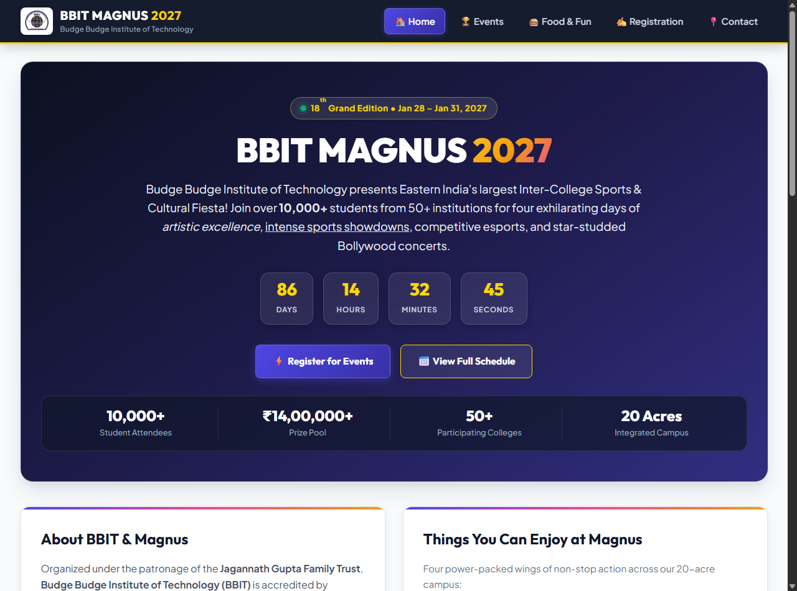
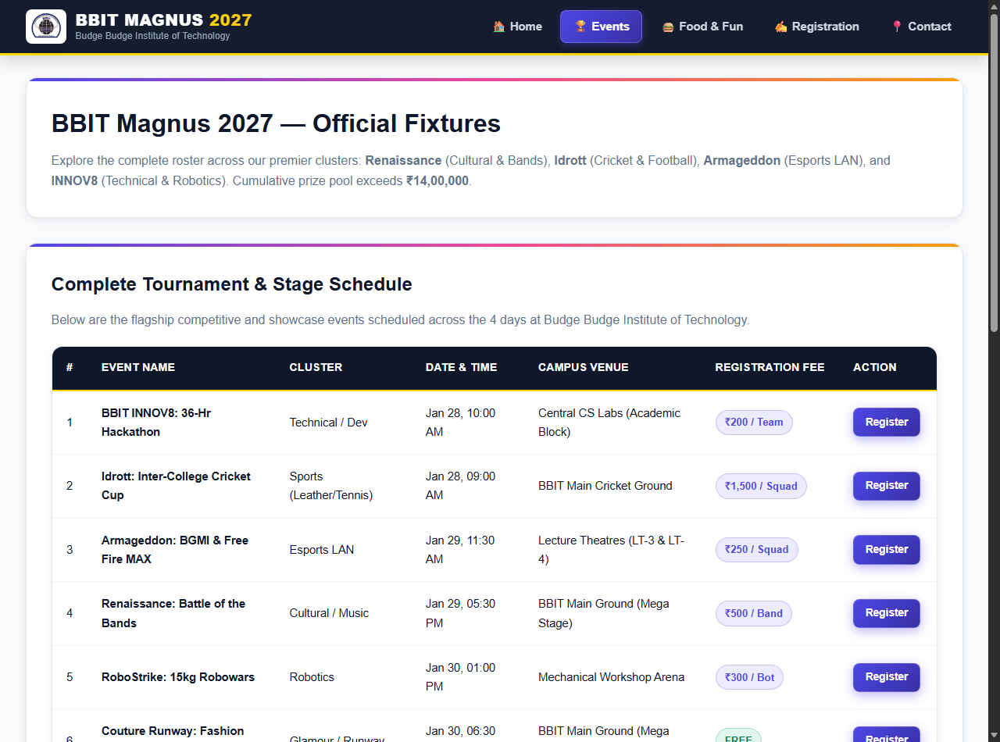
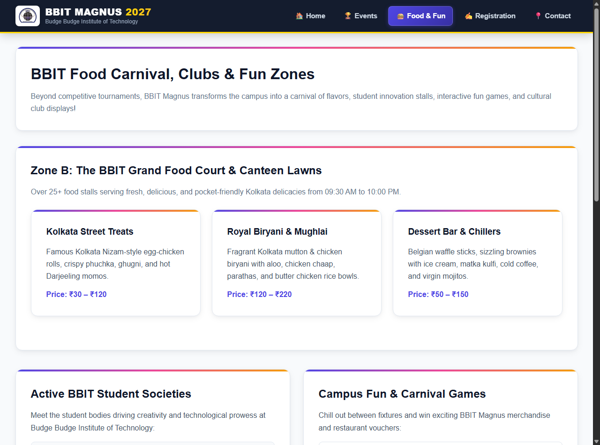
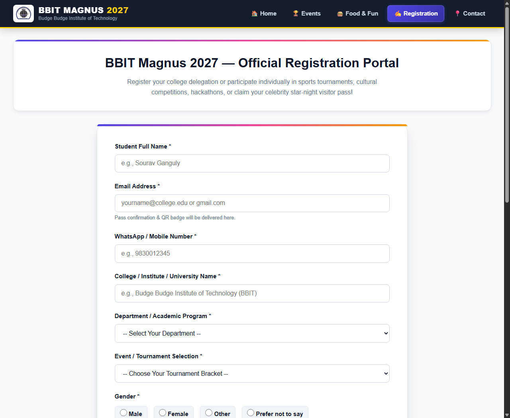
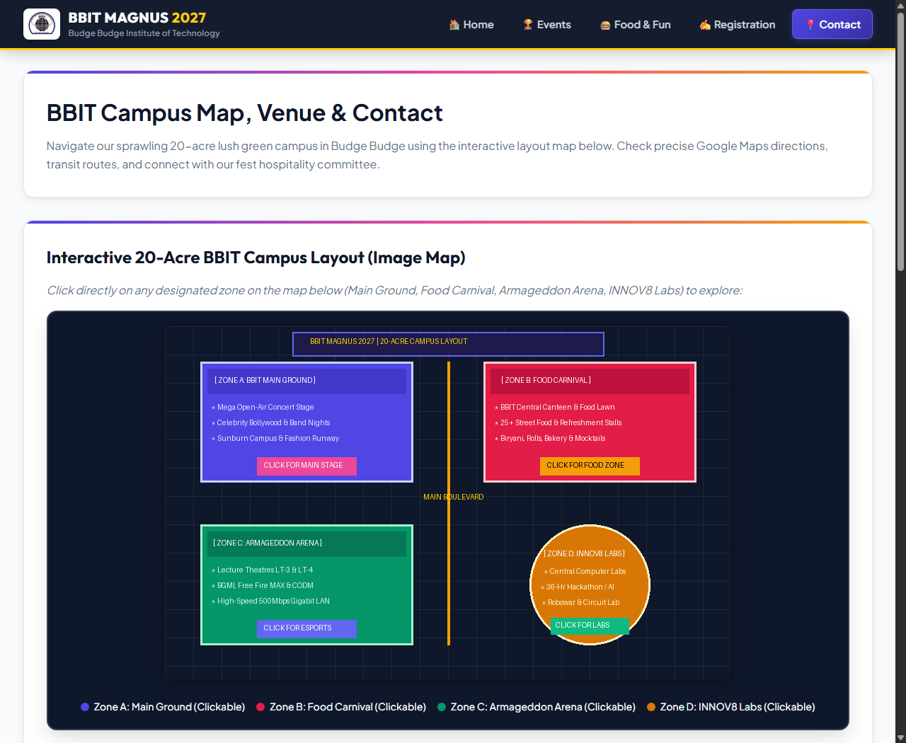

# BBIT Magnus 2027 — Annual College Fest Web Portal

[](https://bbit.edu.in)
[-crimson.svg)](https://bbit.edu.in)
[](https://developer.mozilla.org/en-US/docs/Web/HTML)
[](https://developer.mozilla.org/en-US/docs/Web/CSS)
[](https://github.com/anankush/magnus)

A modern, responsive multi-page web portal designed and developed for **"Magnus 2027"**, the flagship annual sports, technical, and cultural festival of **Budge Budge Institute of Technology (BBIT)**, affiliated with **Maulana Abul Kalam Azad University of Technology (MAKAUT)**.

Developed as a laboratory assignment for the **Internet Technology** subject.

---

## 📌 Repository Information
* **Remote Repository:** [https://github.com/anankush/magnus](https://github.com/anankush/magnus)
* **Subject:** Internet Technology (CS / IT / Diploma Lab)
* **Academic Session:** 2026 – 2027

---

## 👥 Project Contributors

| Contributor Name | Role | GitHub Profile |
| :--- | :--- | :--- |
| **Tuhin Khan** | Development & Design | [@khantuhin57035-star](https://github.com/khantuhin57035-star) |
| **Pranjal Das Sarma** | Architecture & Markup | [@0xLum3n](https://github.com/0xLum3n) |

---

## 📋 Academic Requirements & Implementation Matrix

| Requirement | Implementation Details | Verified Status |
| :--- | :--- | :---: |
| **1. HTML Structure & Formatting** | Semantic tags (`<header>`, `<nav>`, `<section>`, `<article>`, `<div>`, `<footer>`), headings (`<h1>`–`<h6>`), formatting (`<b>`, `<i>`, `<u>`, `<sup>`, `<sub>`), internal/external links. | ✅ Passed |
| **2. Events Table & Lists** | 7-row tournament fixture table (Name, Cluster, Date/Time, Venue, Fee, Action), `<ol>` for registration timeline, `<ul>` for fest attractions. | ✅ Passed |
| **3. CSS & Color Theory** | Color Names (`gold`, `crimson`, `white`, `navy`), HEX values (`#4f46e5`, `#0f172a`), RGB values (`rgb(225, 29, 72)`), flexbox and CSS grid layouts. | ✅ Passed |
| **4. Student Registration Form** | Complete form with Name, Email, Phone, Department `<select>`, Event `<select>`, Gender radio buttons, terms checkbox, Submit & Reset buttons. | ✅ Passed |
| **5. Iframes Integration** | BBIT Google Maps exact coordinates embed and official YouTube concert highlights embed. | ✅ Passed |
| **6. Image Map (`<map>` & `<area>`)** | 20-Acre BBIT campus layout with 4 clickable areas (`rect`, `circle`) routing to Main Stage, Food Zone, Esports, and Tech Labs. | ✅ Passed |
| **7. Multi-Page Navigation** | Sticky header with animated Hamburger menu, smooth transitions, and persistent branding. | ✅ Passed |

---

## 🖥️ Desktop UI Highlights & Page Previews

### 1. Home Page (`index.html`)
Featuring the live 18th edition badge, vibrant hero typography, real-time countdown timer, stats ribbon, about section, the official Magnus equation, and registration steps.



---

### 2. Events & Tournaments (`events.html`)
Comprehensive tournament schedule covering Renaissance (Cultural), Idrott (Sports), Armageddon (Esports LAN), and INNOV8 (36-Hr Hackathon).



---

### 3. Food Court & Student Clubs (`food-fun.html`)
Featuring the BBIT Grand Food Court (Kolkata Street Food, Mughlai Biryani, Desserts), student clubs showcase (GDG on Campus BBIT, Robotics, Drama), and campus fun games.



---

### 4. Student Registration Portal (`register.html`)
Interactive student delegate registration form with validation, department dropdowns, tournament categories, gender selection, and reset/submit controls.



---

### 5. Campus Layout, Directions & Contact (`contact.html`)
Interactive 20-acre BBIT campus image map (`<map>` and `<area>`), live Google Maps iframe, YouTube teaser embed, transit guide, and organizing committee contact information.



---

## 📂 Project Architecture

```text
magnus/
│
├── index.html            # Home page (Fest overview, Countdown, Lists, Equations)
├── events.html           # Events schedule & tournament table (7 flagship events)
├── food-fun.html         # Food carnival stalls, campus clubs & carnival games
├── register.html         # Interactive student registration form
├── contact.html          # Campus image map, Google Maps iframe & contact desk
├── style.css             # Unified modern stylesheet (Light/Navy theme, responsive)
│
├── bbit-logo.png         # Official Budge Budge Institute of Technology logo
├── favicon.png           # 64x64 browser tab icon
├── favicon.ico           # 32x32 standard browser favicon
├── campus-map.png        # 800x500 20-Acre BBIT campus map layout for image map
│
├── screenshots/          # Desktop view UI captures for documentation
│   ├── home.png
│   ├── events.png
│   ├── food-fun.png
│   ├── register.png
│   └── contact.png
│
└── README.md             # Complete academic assignment documentation
```

---

## 🚀 How to Run Locally

### Option 1: Using Python
Navigate to the project root directory and start a local HTTP server:
```bash
python -m http.server 8080
```
Open your browser and visit: **[http://localhost:8080](http://localhost:8080)**

### Option 2: Using Node.js
```bash
npx serve .
```

### Option 3: Direct File Opening
Double-click `index.html` to open it directly in any modern browser (Chrome, Edge, Firefox, Safari).

---

## 📤 Git Push & Upload Instructions

To push this project to the official repository (`https://github.com/anankush/magnus`):

```bash
# 1. Initialize git (if not already initialized)
git init

# 2. Add all files
git add .

# 3. Commit changes
git commit -m "feat: complete BBIT Magnus 2027 fest website for Internet Technology assignment"

# 4. Set main branch
git branch -M main

# 5. Link remote repository
git remote add origin https://github.com/anankush/magnus.git

# 6. Push to GitHub
git push -u origin main
```

---

## 🏫 About the Institution
**Budge Budge Institute of Technology (BBIT)**  
*Affiliated to Maulana Abul Kalam Azad University of Technology (MAKAUT)*  
*Approved by AICTE | Accredited by NAAC & NBA*  
*Address:* KP Mondal Road, Nischintapur, Budge Budge, Kolkata, West Bengal 700137  
*Website:* [https://bbit.edu.in](https://bbit.edu.in)

---

&copy; 2027 Magnus Festival Organizing Committee &bull; Budge Budge Institute of Technology (BBIT). All rights reserved.
